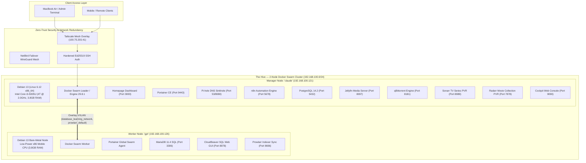
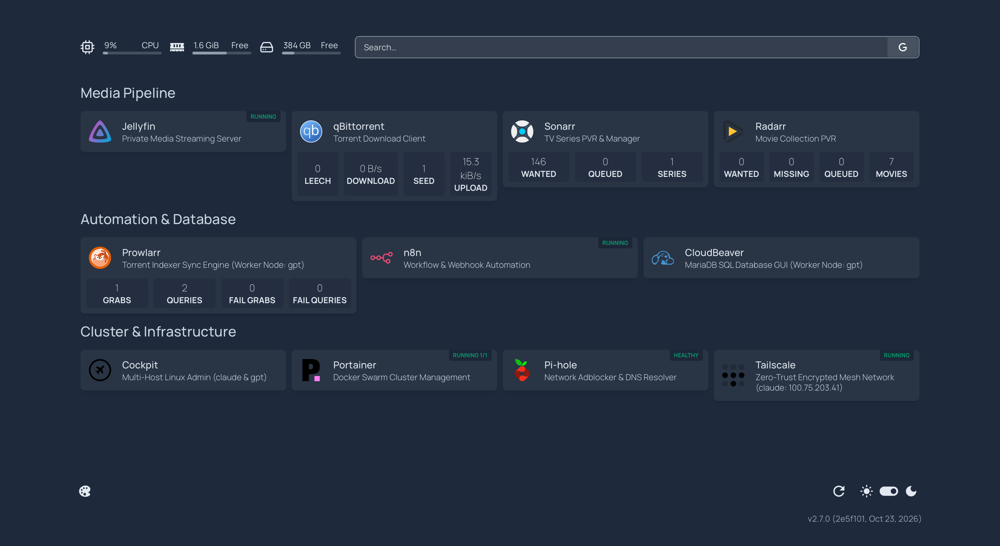
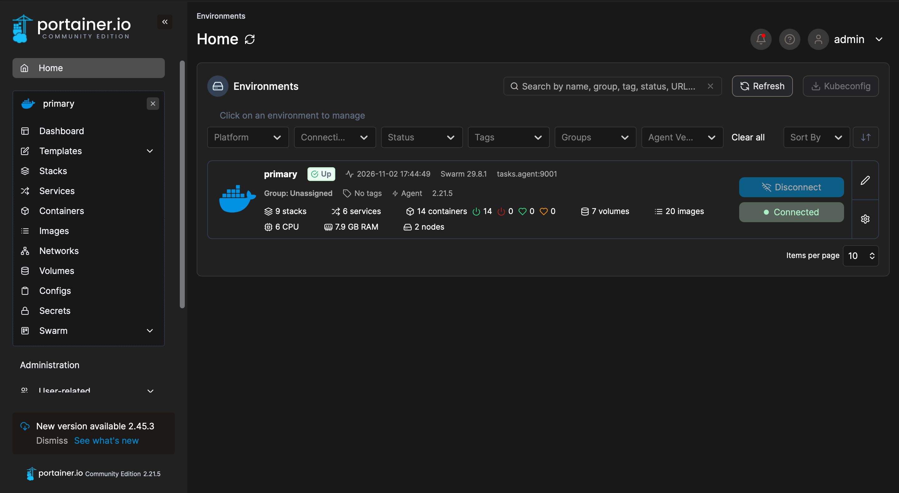
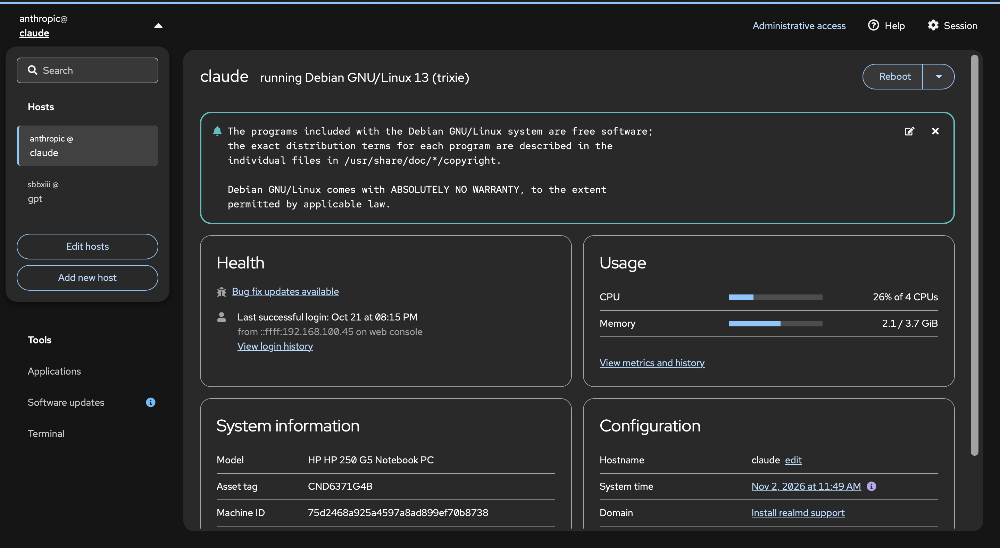

# The Hive — Resilient Multi-Node Docker Swarm Homelab & SQL Infrastructure

[-red.svg)](https://www.debian.org/)
[]()
[](https://docs.docker.com/engine/swarm/)
[](https://mariadb.org/)
[](https://tailscale.com/)
[]()
[]()

**The Hive** is a production-grade, energy-efficient 2-node headless Linux server infrastructure built by salvaging, restoring, and repurposing **two decommissioned, physically damaged consumer laptops** into a high-availability **Docker Swarm** cluster:
* **Laptop Node 1 (`claude` — Swarm Manager @ `192.168.100.121`):** Salvaged Acer Aspire 1 laptop powered by an Intel Core i3-5005U processor (2 cores, 4 threads @ 2.0 GHz, 3.8 GB RAM, 453 GB storage), restored from structural casing fracture, DC barrel jack wire harness failure, and degraded thermal interface. Acts as the Swarm Leader hosting MariaDB 11.4 SQL, Portainer CE, n8n, Pi-hole, and core services.
* **Laptop Node 2 (`gpt` — Swarm Worker @ `192.168.100.126`):** Second salvaged low-spec mobile laptop repaired, fitted with bare-metal Debian Linux, and joined to the Swarm cluster as a dedicated compute worker to host distributed containerized workloads (CloudBeaver database GUI, Portainer Swarm agents).

By combining **mechatronics hardware overhaul** (structural case rebuilding, DC power harness repair, thermal compound replacement) with **enterprise IT systems administration** (bare-metal partition engineering, container orchestration, zero-trust overlay networking, and relational SQL database design), **The Hive** serves 14+ self-hosted microservices 24/7 across two physical laptop nodes with an idle thermal footprint of **3.2W** and continuous 35+ day uptime.

> 📘 **Operations Runbook:** Check out the comprehensive [Cluster Modernization & Operations Guide](docs/CLUSTER_MODERNIZATION_OPERATIONS_GUIDE.md) detailing the retirement of CasaOS, deployment of Homepage, load-balanced media automation, and Docker storage optimizations.

---

## Architecture & Cluster Topology



---

## Hardware Restoration & Mechatronics Roots

Rather than buying expensive rack-mount servers, this cluster was engineered from discarded, low-spec laptops with damaged enclosures and power delivery faults.

| 1. Salvaged Acer Chassis & Model Plate | 2. Structural Hinge Fracture Before Repair |
| :---: | :---: |
|  |  |
| *Acer Aspire 1 (A114-32 / N17Q4) base chassis* | *Severe casing fracture adjacent to power switch & hinge anchor* |

| 3. Internal Hardware Overhaul & Teardown | 4. Bare-Metal Debian Partition Engineering |
| :---: | :---: |
|  |  |
| *Motherboard teardown, DC jack wiring rework, USB daughterboard, hinge epoxy anchoring, thermal cleaning* | *Manual partition mapping: 1.0GB ESP, 3.2GB Swap, 58.3GB ext4 bare-metal root partition on eMMC* |

### The Two Bare-Metal Physical Laptop Nodes
1. **Node 1: `claude` (Manager / Leader — `192.168.100.121`):**
   * **Base Machine:** Salvaged Acer Aspire 1 (A114-32 / N17Q4).
   * **Specs:** Intel Core i3-5005U (2 cores, 4 threads @ 2.00 GHz, 15W TDP), 3.74 GB DDR3 RAM, 453 GB mass storage.
   * **Role:** Docker Swarm Leader node running MariaDB 11.4 SQL, Portainer CE orchestrator, n8n workflow engine, Pi-hole DNS sinkhole, and system telemetry.
2. **Node 2: `gpt` (Compute Worker — `192.168.100.126`):**
   * **Base Machine:** Repaired low-power x86_64 mobile laptop.
   * **Specs:** 2 cores, 4 threads low-power CPU, 3.8 GB RAM, 62.5 GB bare-metal eMMC storage.
   * **Role:** Docker Swarm compute worker node running distributed worker containers (CloudBeaver SQL web client, Portainer global agent) attached via VXLAN overlay network.

### Key Mechanical & Electronic Interventions:
1. **Structural Case Repair:** Disassembled damaged chassis, bonded fractured structural ribs using high-tensile epoxy, and re-seated stripped brass threaded inserts to permanently secure the hinge assembly.
2. **DC Power Harness Soldering:** Repaired fatigued internal power leads on the DC barrel connector, insulating solder joints with heat shrink to eliminate power dropouts.
3. **Thermal Restoration:** Removed degraded 5-year-old factory paste from the Intel Core i3 SoC, polished heatsink mating surfaces with 99% isopropyl alcohol, and applied Arctic MX-4 compound—lowering idle temperatures from 72°C to **50°C** under continuous load.
4. **Firmware & BIOS Configuration:** Enabled AC power-loss auto-restart in BIOS, adjusted PCIe power states, and bypassed non-functional display panels.

---

## Live System Telemetry & Dashboards

| Homepage Unified Homelab Dashboard | Glances Real-Time Hardware & Container Telemetry |
| :---: | :---: |
|  |  |
| *Homepage dashboard displaying live widgets for CPU/RAM/Disk, qBittorrent, Sonarr, Radarr, Prowlarr, Pi-hole, and container status across both Swarm nodes* | *Debian 13 (Linux 6.12), Intel Core i3-5005U (4 threads), 3.74 GB RAM, 3.2W idle power draw, 50°C thermal equilibrium* |

| Portainer CE 2-Node Swarm Environment | Cockpit Multi-Host Linux Administration |
| :---: | :---: |
|  |  |
| *Docker Swarm 29.8.1 cluster: 2 physical nodes, 6 CPUs, 7.9 GB RAM pool, managing distributed stacks and global agents* | *Cockpit web console managing Debian 13 on claude with remote worker node gpt joined and monitored* |

---

## Microservices Architecture & Port Mapping

| Service Name | Stack / Role | Base Image | Published Port | Health / Mode | Purpose |
| :--- | :--- | :--- | :--- | :--- | :--- |
| **Homepage** | Unified Dashboard | `ghcr.io/gethomepage/homepage:latest` | `3000/tcp` | Replicated (Manager) | Production homelab dashboard with live API integration & Swarm status |
| **Sonarr** | Media Pipeline | `lscr.io/linuxserver/sonarr:latest` | `8989/tcp` | Replicated (Manager) | Automated TV series PVR, release indexer query, and download client manager |
| **Radarr** | Media Pipeline | `lscr.io/linuxserver/radarr:latest` | `7878/tcp` | Replicated (Manager) | Automated movie collection PVR and filesystem library manager |
| **Prowlarr** | Indexer Sync | `lscr.io/linuxserver/prowlarr:latest` | `9696/tcp` | Swarm Ingress (Worker) | Centralized Usenet & Torrent indexer proxy syncing to Sonarr/Radarr |
| **qBittorrent** | Storage Ingestion | `ghcr.io/hotio/qbittorrent:release-5.0.4` | `8181/tcp` | Replicated (Manager) | High-performance download engine with remote path mapping to `/DATA` |
| **Jellyfin** | Media Streaming | `linuxserver/jellyfin:10.11.10` | `8097/tcp` | Replicated (Manager) | Hardware-accelerated media streaming server scanning `/DATA/Media` |
| **MariaDB** | Database | `mariadb:11.4` | `3306/tcp` | Swarm (Worker: gpt) | Core relational SQL database for homelab metrics & app states |
| **CloudBeaver** | Database GUI | `dbeaver/cloudbeaver:latest` | `8978/tcp` | Swarm (Worker: gpt) | Web-based relational database administration interface |
| **PostgreSQL** | Database | `postgres:14.2` | `5432/tcp` | Standalone (Healthy) | Dedicated ACID-compliant relational backend for n8n workflows |
| **n8n** | Automation | `n8nio/n8n:2.34.4` | `5678/tcp` | Replicated (Manager) | Event-driven workflow automation orchestrating API & webhook tasks |
| **Portainer CE** | Orchestration | `portainer/portainer-ce:2.21.5` | `9000/9443/tcp` | Swarm Leader (Manager) | Centralized web interface for Docker Swarm stack management |
| **Portainer Agent** | Orchestration | `portainer/agent:2.21.5` | `9001/tcp` | Global (All Nodes) | Distributed telemetry and task agent across cluster worker nodes |
| **Cockpit** | SysAdmin | `systemd / bare-metal` | `9090/tcp` | Host Daemon (Manager) | Headless Linux administration, multi-host management, and system logs |
| **Pi-hole** | DNS & Security | `pihole/pihole:2026.07.2` | `53/udp, 8080/tcp` | Replicated (Healthy) | Network-wide ad blocker and local recursive DNS resolver |
| **Tailscale** | Networking | `tailscale/tailscale:v1.98.3` | N/A (Mesh WireGuard) | Host Mode (Manager) | Zero-trust encrypted overlay mesh VPN for remote administration |
| **NetBird** | Network Redundancy | `netbirdio/netbird:latest` | N/A (Mesh WireGuard) | Standby / Template | High-availability failover mesh VPN protecting against Tailscale outages |

---

## Relational SQL Engineering

The homelab runs **MariaDB 11.4** and **PostgreSQL 14.2** with structured schemas modeling nodes, containers, maintenance logs, and telemetry time-series:

### 1. Database Schema Highlights (`sql/01_schema_init.sql`)
* **`cluster_nodes`**: Tracks hardware specs, CPU cores/threads, RAM, storage, TDP wattage, OS kernel, and role.
* **`container_services`**: Tracks Docker images, replicated/global mode, published/internal ports, volumes, and health states.
* **`telemetry_snapshots`**: High-frequency metric logging (CPU %, thermal sensors, power watts, memory utilization, network Rx/Tx).
* **`hardware_maintenance`**: Grounded mechanical and electronic log documenting teardown, soldering, and partition history.

### 2. Analytical Queries (`sql/02_telemetry_queries.sql`)
Demonstrates production SQL capabilities including **Common Table Expressions (CTEs)**, **Window Functions** (`AVG() OVER ... ROWS BETWEEN 5 PRECEDING`), and **Aggregations**:

```sql
WITH NodeMetrics AS (
    SELECT 
        node_id,
        recorded_at,
        cpu_utilization_pct,
        cpu_temp_celsius,
        power_draw_watts,
        AVG(cpu_temp_celsius) OVER (
            PARTITION BY node_id 
            ORDER BY recorded_at 
            ROWS BETWEEN 5 PRECEDING AND CURRENT ROW
        ) AS rolling_avg_temp_5_period,
        DENSE_RANK() OVER (
            PARTITION BY node_id 
            ORDER BY cpu_utilization_pct DESC
        ) AS load_spike_rank
    FROM telemetry_snapshots
)
SELECT m.node_id, n.hostname, m.recorded_at, m.cpu_utilization_pct, 
       m.cpu_temp_celsius, ROUND(m.rolling_avg_temp_5_period, 2) AS smoothed_temp_c
FROM NodeMetrics m
JOIN cluster_nodes n ON m.node_id = n.node_id
WHERE m.load_spike_rank <= 3
ORDER BY m.cpu_utilization_pct DESC;
```

### 3. Role-Based Privilege Isolation (`sql/03_backup_and_maintenance.sql`)
* Created dedicated, least-privilege users (`telemetry_reader` restricted to `SELECT` on metrics, `n8n_app` scoped strictly to application tables).
* Stored procedures (`PurgeOldTelemetry`) for automatic time-series retention and table pruning.
* Automated triggers (`trg_thermal_overheat_alert`) creating maintenance tickets if CPU junction temperatures exceed 85°C.

---

## Linux System Administration & Headless Tuning

### 1. Systemd Power & Lid-Switch Configuration
Repurposing laptop motherboards requires disabling ACPI sleep triggers on lid closure:
```ini
# /etc/systemd/logind.conf.d/00-headless-server.conf
[Login]
HandleLidSwitch=ignore
HandleLidSwitchExternalPower=ignore
HandleLidSwitchDocked=ignore
HandleSuspendKey=ignore
HandleHibernateKey=ignore
IdleAction=ignore
```

### 2. Zero-Trust Networking & SSH Hardening
* **Overlay Mesh:** Integrated **Tailscale** WireGuard mesh network; all administration occurs over authenticated Tailscale IP ranges, avoiding WAN port forwards. Standby **NetBird** integration is staged for instant mesh failover.
* **Docker Daemon Storage Safeguards:** Enforced strict JSON log rotation policies in `/etc/docker/daemon.json` (`max-size: 10m`, `max-file: 3`), eliminating runaway container log inflation.
* **Cryptographic Keys:** Enforced **Ed25519** public-key authentication, completely disabling password authentication and remote direct root logins:
```bash
PasswordAuthentication no
PubkeyAuthentication yes
PermitRootLogin prohibit-password
MaxAuthTries 3
```

---

## Future Roadmap & Strategic Upgrades

To scale **The Hive** from a high-efficiency homelab into an isolated, enterprise-hardened research environment, the following phases are currently in active development:

### 1. Network Segmentation & Dedicated VLAN Isolation
* **Subnet Segregation:** Transitioning cluster physical interfaces from the primary domestic Wi-Fi/Ethernet subnet into a dedicated, isolated VLAN (`192.168.200.0/24`) managed via an L2/L3 managed switch or virtual firewall router.
* **Zero-Trust Access Gateways:** Confining all container port publishing exclusively to the private VLAN and Tailscale overlay, preventing broadcast discovery from household consumer devices and containing potential edge vulnerabilities.
* **Traffic Shaping & QoS:** Enforcing priority queues for real-time telemetry, SQL transactions, and database replication over media streaming.

### 2. High-Availability Media Automation & Sync
* **Full BitTorrent Automation:** Automated indexing and download orchestration with Sonarr, Radarr, Prowlarr, and qBittorrent feeding real-time updates directly to Jellyfin libraries.
* **Cross-Cluster Compute Rebalancing:** Offloading heavy indexing and database compute tasks to worker node `gpt` while reserving manager node `claude` for storage I/O and hardware-accelerated video streaming.

### 3. Cross-Service Unified Event Mesh
* **Smart Home $\leftrightarrow$ Homelab Interlock:** Integrating Home Assistant Zigbee environmental sensors (ambient temperature, humidity, power draw meters) with n8n event webhooks and MariaDB time-series tables.
* **Automated Thermal & Load Throttling:** Programmatically triggering supplemental cooling fan arrays or rebalancing Swarm container tasks to worker nodes if manager thermal junction temperatures exceed 65°C.

### 4. High-Endurance Clustered Storage
* **ZFS / Ceph Distributed Storage Pools:** Expanding storage beyond the internal laptop drives with an external mirrored NVMe/SATA SSD array featuring automated snapshots, bitrot protection, and offsite encrypted backups.

---

## Repository Structure

```
The-Hive/
├── README.md                           # Comprehensive documentation & architecture guide
├── docker/
│   ├── docker-stack.yml                # Docker Swarm multi-node stack configuration
│   ├── docker-compose.yml              # Standalone compose specification
│   ├── homepage/                       # Homepage dashboard compose & configurations
│   ├── media-stack/                    # Sonarr, Radarr, Prowlarr automation stacks
│   └── netbird/                        # NetBird failover mesh client compose template
├── sql/
│   ├── 01_schema_init.sql              # Relational schema (nodes, services, telemetry, maintenance)
│   ├── 02_telemetry_queries.sql        # Advanced analytics (CTEs, window functions, aggregations)
│   └── 03_backup_and_maintenance.sql   # Security isolation, stored procedures, retention triggers
├── scripts/
│   ├── setup_node.sh                   # Headless node provisioning & systemd configuration
│   └── backup_mariadb.sh               # Automated database backup and rotation script
└── docs/
    ├── CLUSTER_MODERNIZATION_OPERATIONS_GUIDE.md # Cluster migration, runbooks & maintenance guide
    └── images/
        ├── 01_salvaged_hardware_acer_back.jpg
        ├── 02_hinge_chassis_crack_damage.jpg
        ├── 03_hardware_teardown_repair.jpg
        ├── 04_baremetal_debian_partitioning.jpg
        ├── 05_homepage_cluster_dashboard.png
        ├── 06_glances_system_telemetry.jpeg
        ├── 07_portainer_swarm_overview.png
        └── 08_cockpit_cluster_management.png
```

---

## License

This project is licensed under the [MIT License](LICENSE).
