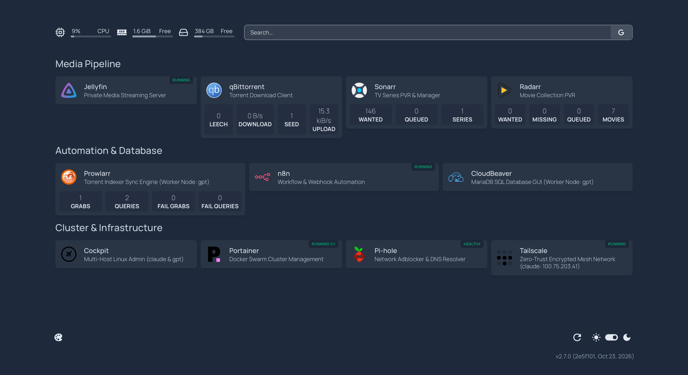
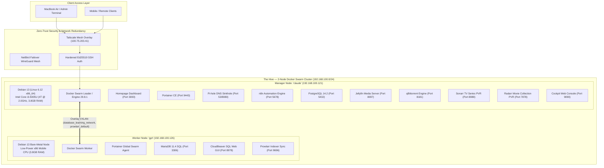

# The Hive — Cluster Modernization & Operations Guide

> **Cluster Profile:** 2-Node Headless Docker Swarm Homelab  
> **Manager Node (`claude`):** `192.168.100.121` | Tailscale: `100.75.203.41` | Debian 13 (Linux 6.12)  
> **Worker Node (`gpt`):** `192.168.100.126` | Debian 13 Bare-Metal Worker  
> **Repository:** [github.com/sbbxiii/The-Hive](https://github.com/sbbxiii/The-Hive)

---

## 1. Executive Summary of Modernization



This operations guide documents the transition of **The Hive** from an ad-hoc collection of standalone containers and CasaOS daemons into a resilient, load-balanced, production-grade homelab cluster:

1. **Replaced CasaOS with Homepage:** Gracefully retired all CasaOS systemd background daemons without disturbing running containers, replacing it with a production-grade **Homepage** dashboard with real-time API telemetry across both nodes.
2. **Engineered a Hybrid Load-Balanced Media Automation Stack:** Deployed **Sonarr** and **Radarr** on `claude` (Manager), load-balanced **Prowlarr** across the Docker Swarm overlay network onto `gpt` (Worker), and connected them to **qBittorrent** with remote path mappings.
3. **Fixed Jellyfin Streaming & Standardized Media Organization:** Resolved Jellyfin's virtual path resolution, reorganized loose legacy movie downloads into standard release folders, wiped redundant directories, and synced all 7 titles across both Jellyfin and Radarr.
4. **Purged Legacy AI & Discontinued Workloads:** Completely decommissioned Ollama, Open Interpreter, SpiderFoot OSINT, and God's Eye View, reclaiming memory and compute resources.
5. **Reclaimed >10 GB Disk & Enforced Storage Safeguards:** Fixed an unrotated 278 MB container log, enforced daemon-wide log rotation in `/etc/docker/daemon.json`, pruned dangling images and volumes, and brought reclaimable Docker waste down to **0B (0%)** across both physical nodes.
6. **Staged NetBird WireGuard Mesh Failover:** Prepared an automated standby NetBird client stack to provide instant remote access redundancy if Tailscale experiences service disruption.
7. **Documented & Pushed to GitHub:** Synced all compose files, sanitized secrets, updated system topology diagrams, and published live dashboard screenshots directly to [github.com/sbbxiii/The-Hive](https://github.com/sbbxiii/The-Hive).

---

## 2. Updated Architecture & Service Topology



---

## 3. Media Pipeline & Storage Layout

### Storage Structure (`/DATA/Media/Movies/`)
Every movie complies with the universal Sonarr/Radarr and Jellyfin directory hierarchy:
```
/DATA/Media/Movies/
├── Hamilton (2025)/
│   └── Hamilton.2020.1080p.WEBRip.x264.AAC5.1-[YTS.MX].mp4
├── Project Hail Mary (2026)/
│   └── Project.Hail.Mary.2026.1080p.BluRay.Remux.MULTi.TrueHD.Atmos.H264-BTM.mkv
├── Shrek (2001)/
│   └── Shrek.2001.1080p.BluRay.x264.YIFY.mp4
├── Shrek 2 (2004)/
│   └── Shrek.2.2004.1080p.BluRay.x264.YIFY.mp4
├── Shrek the Third (2007)/
│   └── Shrek.The.Third.2007.1080p.HDDVD.x264.YIFY.mp4
├── Shrek Forever After (2010)/
│   └── Shrek.4.2010.1080p.BluRay.x264.YIFY.mp4
└── The Hunger Games - The Ballad of Songbirds & Snakes (2023)/
    └── The.Hunger.Games.The.Ballad.of.Songbirds.and.Snakes.2023.1080p.AMZN.WEBRip.DDP5.1.x265.10bit-GalaxyRG265.mkv
```

### Automation & Download Mapping
* **qBittorrent Report Path:** `/app/qBittorrent/downloads/`
* **Host Physical Path:** `/DATA/AppData/qbittorrent/config/downloads/`
* **Remote Path Mapping:** Configured in Sonarr and Radarr settings so completed torrents are automatically linked, renamed, and moved into `/DATA/Media/`.

---

## 4. Docker Storage Optimization & System Hardening

Container logs on Debian/Docker default to unlimited size. We placed a permanent policy in `/etc/docker/daemon.json` and reloaded the daemon with zero downtime:
```json
{
  "log-driver": "json-file",
  "log-opts": {
    "max-size": "10m",
    "max-file": "3"
  }
}
```

### Cleaned Items & Space Reclaimed:
- **Tailscale JSON Log:** Truncated 278 MB unrotated log file down to 0 bytes.
- **Dangling Local Volumes:** Archived `database_mariadb_data` (168 MB) and `database_cloudbeaver_data` to `/DATA/AppData/backups/`, removing orphaned volumes on `claude`.
- **Dead Configurations:** Removed `/DATA/AppData/big-bear-glance`.
- **CasaOS Daemons:** Backed up compose definitions to `/DATA/AppData/compose-stacks/` and disabled all 6 `casaos*` systemd units.
- **Prune Execution:** Ran full image, container, volume, and build-cache pruning on both `claude` and `gpt`.

**Current Storage Status:**
- `/dev/sda2`: **358 GB Available** (17% used)
- Docker System DF: **0B Reclaimable (0% Waste)** across images, containers, and volumes.

---

## 5. High-Availability Remote Access: Tailscale & NetBird

* **Tailscale (Active):** Connected on `claude` (`100.75.203.41`), accessible from your Mac terminal and browser.
* **NetBird (Standby Failover):**
  - Compose template staged at `/DATA/AppData/netbird/docker-compose.yml`.
  - NetBird operates on interface `wt0`, preventing any collision with Tailscale's `tailscale0`.
  - When you register at [app.netbird.io](https://app.netbird.io), copy a **Setup Key**, paste it into `/DATA/AppData/netbird/.env`, and launch the container for instant mesh redundancy.

---

## 6. Service URL Directory & Authentication Reference

| Service | Node | Internal URL | Port | Default / Monitored State |
| :--- | :--- | :--- | :--- | :--- |
| **Homepage** | `claude` | `http://192.168.100.121:3000` | 3000 | Live Dashboard & Swarm Monitor |
| **Jellyfin** | `claude` | `http://192.168.100.121:8097` | 8097 | 7 Movies Indexed with Artwork |
| **qBittorrent** | `claude` | `http://192.168.100.121:8181` | 8181 | Default admin credentials |
| **Sonarr** | `claude` | `http://192.168.100.121:8989` | 8989 | Automated TV PVR |
| **Radarr** | `claude` | `http://192.168.100.121:7878` | 7878 | Automated Movie PVR |
| **Prowlarr** | `gpt` | `http://192.168.100.121:9696` | 9696 | Swarm Ingress Indexer Proxy |
| **CloudBeaver** | `gpt` | `http://192.168.100.121:8978` | 8978 | MariaDB Web SQL Client |
| **n8n** | `claude` | `http://192.168.100.121:5678` | 5678 | Automation Engine |
| **Cockpit** | `claude` | `https://192.168.100.121:9090` | 9090 | Linux System Admin (`anthropic`) |
| **Portainer CE** | `claude` | `https://192.168.100.121:9443` | 9443 | Swarm Cluster Management |
| **Pi-hole** | `claude` | `http://192.168.100.121:8080/admin` | 8080 | DNS Adblocker |
| **Tailscale** | `claude` | `100.75.203.41` | Host | Mesh Peer Active |
